# RFC — Banco Universitário

|  |  |
| --- | --- |
| **Time** | Equipe Bootcamp |
| **Data** | 12/10/2026 |
| **Versão** | 8 |

## Contextualização

### Entendendo o problema

O projeto consiste em um banco digital para estudantes universitários. O sistema oferece operações de gestão de contas correntes e poupança, transferências, divisão de despesas, resgate de benefícios e contratação de seguros. O modelo permite múltiplas contas por cliente; não há uma operação específica de subconta.

É necessário garantir a segurança do dinheiro sob concorrência. A solução deve ser capaz de lidar com requisições simultâneas, retentativas de rede, possíveis transações duplicadas ou divergência de valores no extrato. Fica fora do escopo desta entrega integrações com open finance, operações de crédito e investimentos.

### Explicando a solução de forma macro

A solução utiliza uma arquitetura limpa em camadas:

* **Validação de Entrada:** Os dados entram protegidos por schemas, rejeitando valores inválidos na camada de *Resources*.
* **Segurança Transacional:** A lógica do negócio reside nos *Controllers*, que gerenciam sessões unificadas via contexto de requisição.
* **Como garantir integridade:** Transferências exigem uma `idempotency_key` com restrição `UNIQUE` mapeada diretamente no banco de dados. Tentativas de duplicidade disparam `IntegrityError` tratadas como conflito (`409`).
* **Como controlar a concorrência:** Transferências bloqueiam as contas envolvidas com `FOR UPDATE`, ordenadas pelo ID da conta. Essa ordem reduz o risco de *deadlock* entre transferências que seguem o mesmo fluxo; não é uma garantia geral contra *deadlocks* em qualquer operação futura.
* `Soft delete` — não implementada: a API atual não oferece exclusão de clientes, contas ou transações. A exclusão física pode comprometer referências e auditoria; *soft delete*, por si só, preserva os registros.
* `N Tabelas para N tipos de contas` — descartada porque multiplicaria a complexidade das consultas de extrato e aumentaria a chance de *deadlocks*. O modelo com tabela de tipos (`account_type`) permite esta flexibilidade.
* `Paginação via Offset no extrato` — o método de controller existente usa cursor pelo ID crescente da transação. O cursor permite continuar a consulta após o último ID retornado; não representa um snapshot imutável diante de novas inserções.

## Implementação

### Rotas e Contratos

> **Nota:**
> As rotas `GET /` e `GET /health_check` são públicas. As demais rotas registradas exigem `INTERNAL-TOKEN`; sem ele ou com valor incorreto, a resposta é `403 Forbidden`.
> Erros de domínio usam o envelope `{title, description, translation, code}`.

| Método | Caminho | O que faz | Entrada | Saídas |
| --- | --- | --- | --- | --- |
| `GET` | `/` | Identifica o serviço. | Aberta, sem token. | `200` com `service` e `id` do processo. |
| `GET` | `/health_check` | Verifica a saúde do serviço. | Aberta, sem token. | `204 No Content`. |
| `POST` | `/customers` | Cadastra o estudante após validar o formato e a matemática do CPF e consultar o vínculo acadêmico. | `INTERNAL-TOKEN`, `document` (11 dígitos), `university_id`, `course_id` | `201` com `customer_key`; `400 QIT000001` schema inválido; `403 QIT000002` token ausente/inválido; `409 QIT001410` CPF duplicado; `422 QIT001424` CPF inválido ou `QIT001425` vínculo inválido; `502 QIT001502` falha na API universitária; `504 QIT001504` timeout. |
| `POST` | `/accounts` | Abre uma conta corrente ou poupança para um cliente. | `INTERNAL-TOKEN`, `customer_key` (UUID), `type_id` (inteiro >= 1) | `201` com `account_key`; `400 QIT000001` payload inválido; `403 QIT000002` token inválido; `404 QIT001101` cliente inexistente; `500 QIT001500` status inicial não configurado. |
| `POST` | `/transactions` | Realiza uma transferência financeira em centavos. | `INTERNAL-TOKEN`, `idempotency_key` (mínimo 5 caracteres), `origin_account_key`, `destination_account_key` (UUIDs), `amount` (inteiro >= 1) | `201` com `transaction_key`; `400 QIT000001` schema inválido ou `QIT001429` origem e destino iguais; `403 QIT000002` token inválido; `404 QIT001102` conta de origem ou destino inexistente; `409 QIT001412` chave de idempotência duplicada; `422 QIT001427` saldo insuficiente. |
| `GET` | `/accounts/{account_key}/transactions` | Consulta débitos e créditos de uma conta, paginados por cursor. | `INTERNAL-TOKEN`, `account_key` (UUID), `limit` (opcional, padrão 10, de 1 a 100), `cursor` (opcional, ID positivo da última transação) | `200` com `data` e `next_cursor`; `400 QIT000010` UUID ou parâmetro inválido; `403 QIT000002` token inválido; `404 QIT001102` conta inexistente. |
| `GET` | `/benefits` | Lista o catálogo de benefícios e parceiros com seus alvos de elegibilidade. | `INTERNAL-TOKEN` | `200` com `data` (lista, vazia quando não há benefícios); `403 QIT000002` token inválido. |
| `POST` | `/benefits/{key}/redemptions` | Resgata um benefício sujeito à elegibilidade de curso e universidade. | `INTERNAL-TOKEN`, `customer_key` (UUID) | `201` com `voucher_code`; `400 QIT000001` payload inválido; `403 QIT000002` token inválido; `404 QIT001101` cliente ou `QIT001103` benefício inexistente; `409 QIT001409` benefício já resgatado; `422 QIT001422` universidade ou `QIT001423` curso inelegível. |
| `POST` | `/insurances` | Contrata um seguro para o cliente. | `INTERNAL-TOKEN`, `customer_key` (UUID), `insurance_id` (inteiro >= 1) | `201` com `policy_number` (UUID); `400 QIT000001` payload inválido; `403 QIT000002` token inválido; `404 QIT001101` cliente ou `QIT001104` seguro inexistente; `409 QIT001411` seguro já contratado. |
| `POST` | `/transactions/{transaction_key}/splits` | Registra a divisão do valor de uma transação entre contas pagadoras. | `INTERNAL-TOKEN`, `splits` (array não vazio de objetos `{account_key, amount}`; UUID e inteiro >= 1) | `201` divisão registrada; `400 QIT000001` schema inválido ou `QIT001400` conta pagadora duplicada; `403 QIT000002` token inválido; `404 QIT001105` transação inexistente; `422 QIT001428` soma diferente do total ou `QIT001426` conta pagadora inexistente. |

### Banco de Dados (Diagrama ER)

## Principal desafio arquitetural
> * **Qual é:** Preservar a consistência dos saldos e a rastreabilidade das operações financeiras sob concorrência.
> * **Por que é difícil:** Retentativas de rede ou execuções simultâneas podem gerarobreposição e negativando a conta de forma indevida.
> * **Como o desenho implementado ajuda:** A tabela `account` possui `CHECK (balance >= 0)`, `transaction.idempotency_key` é `UNIQUE`, e a transferência bloqueia as contas com `FOR UPDATE` em ordem crescente de ID. A regra de saldo no controller compara o saldo de origem com o valor da transferência. Essas medidas protegem o saldo e evitam repetição da chave; não há constraint ou trigger que impeça alterações/exclusões diretas no histórico de transações.

### Diagrama

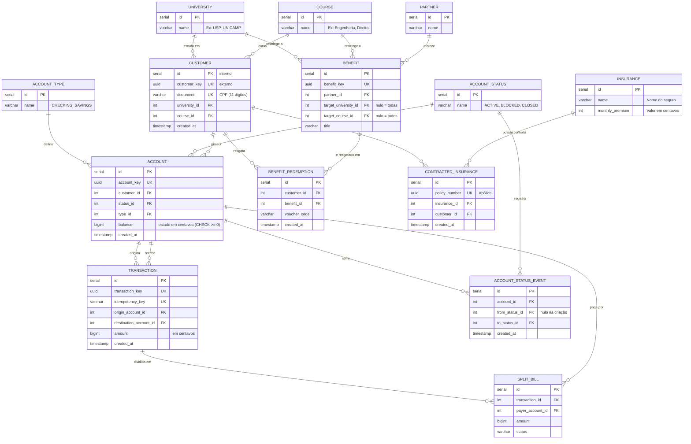

---

### Fluxos

**1. Transação de Transferência**

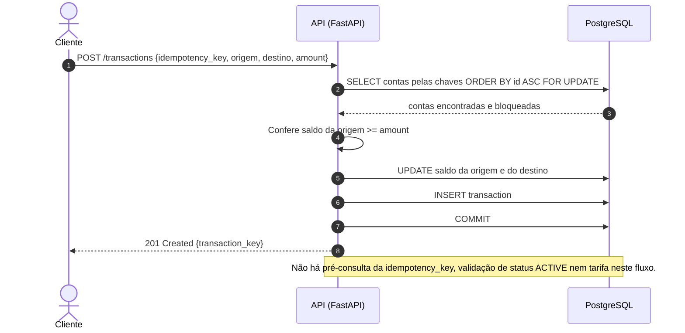

**2. Retentativa com a mesma chave de idempotência**

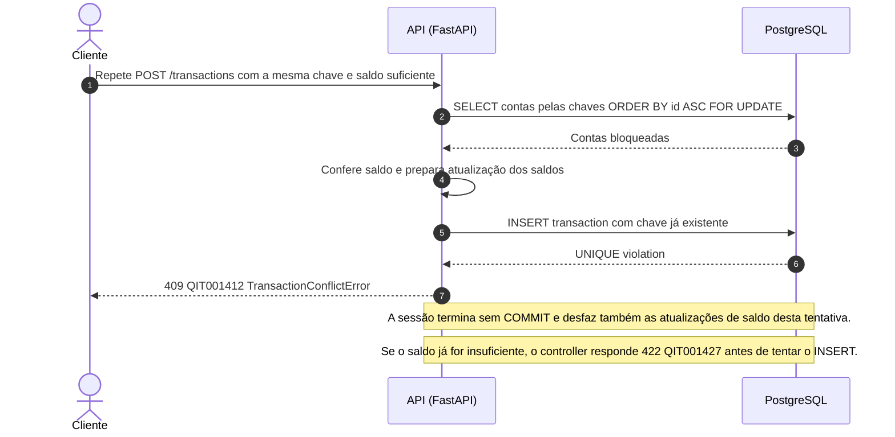

**3. Duas transferências disputam o mesmo saldo**

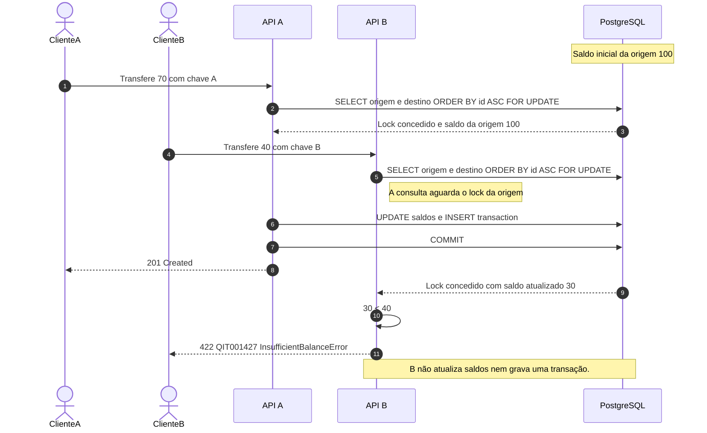

**4. Cadastro de Cliente**

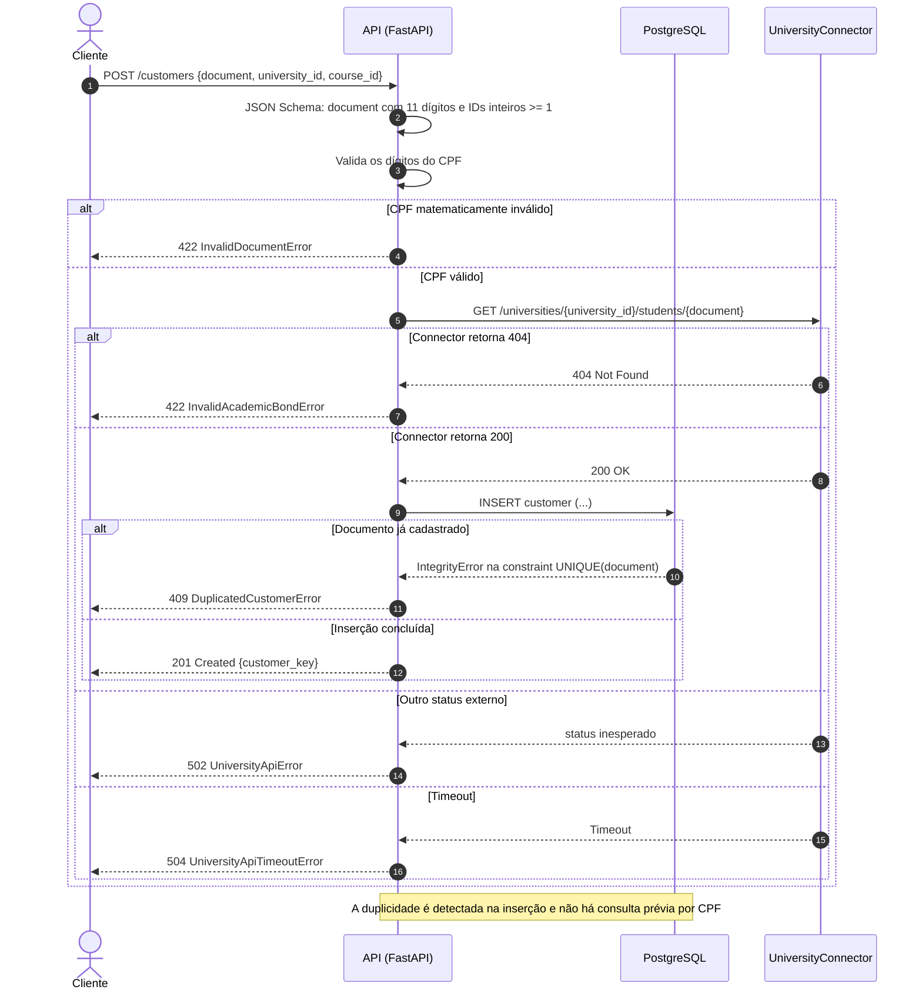

**5. Divisão de Conta com sucesso**

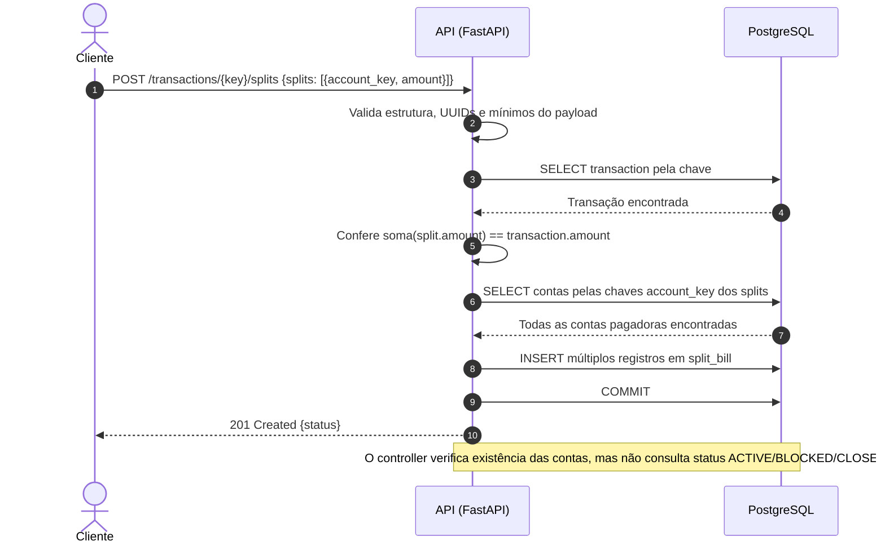

**6. Divisão de Conta — item inválido ou pagador duplicado**

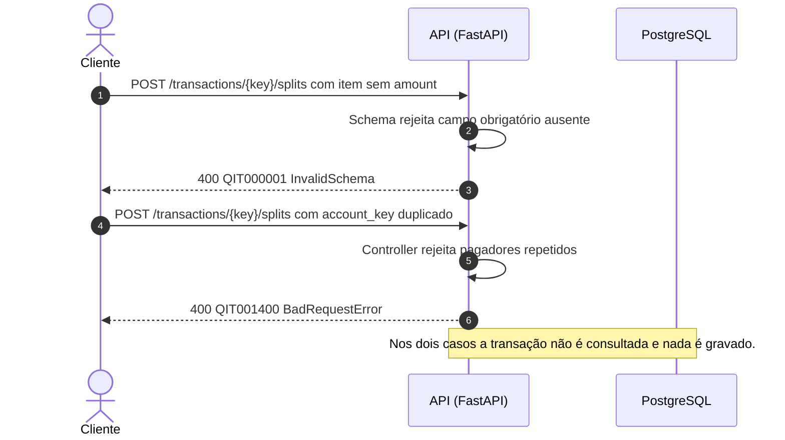

**7. Divisão de Conta — transação inexistente**

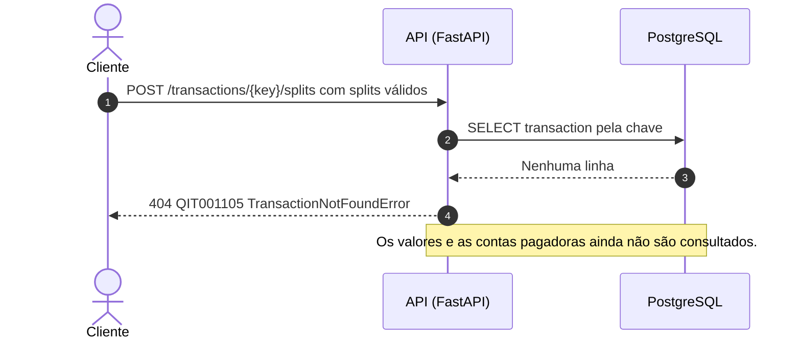

**8. Divisão de Conta — soma diferente do total**

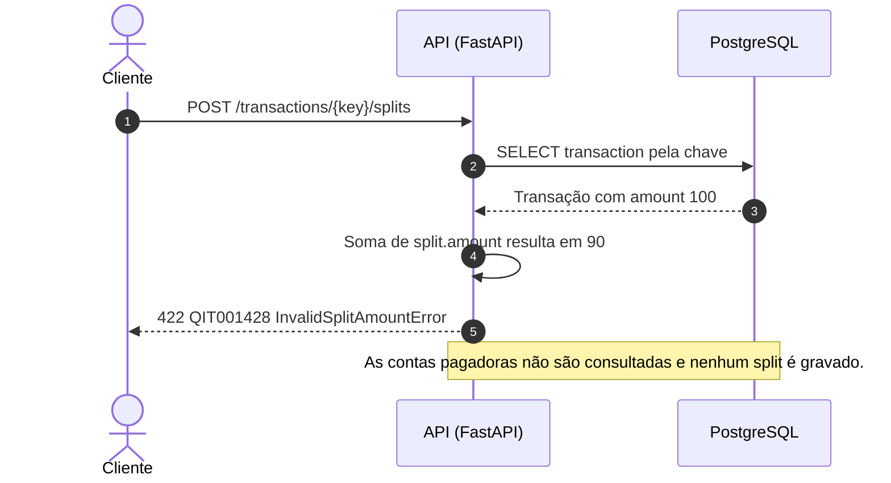

**9. Divisão de Conta — pagador inexistente**

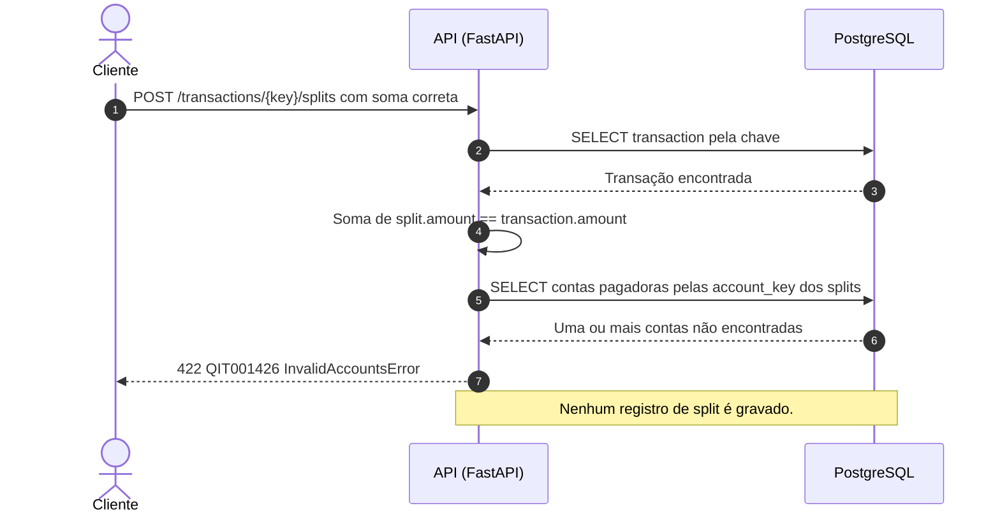

**10. Abertura de Conta**

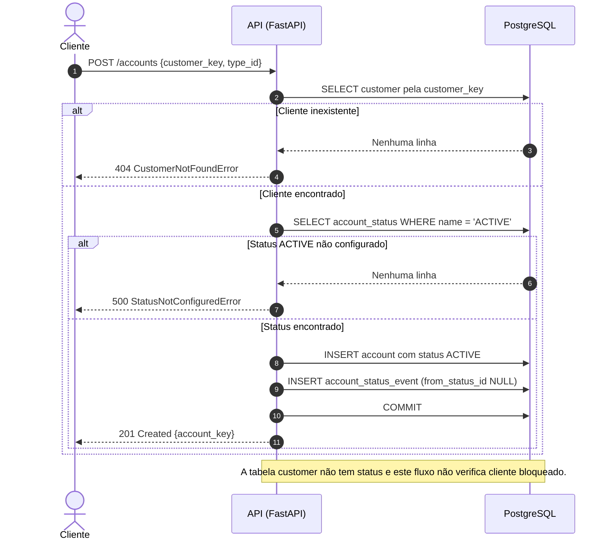

**11. Autenticação das Rotas**

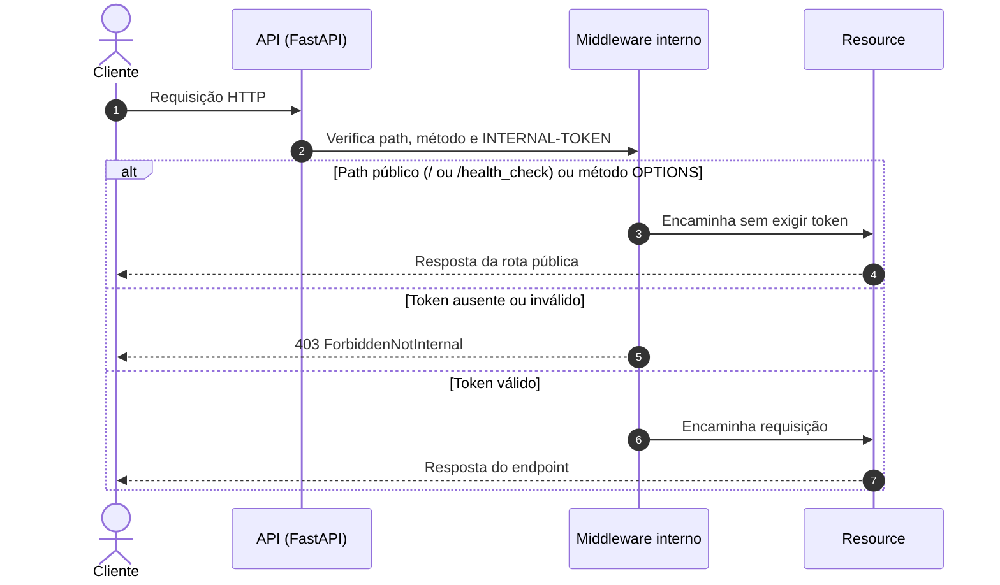

**12. Resgate de Benefício**

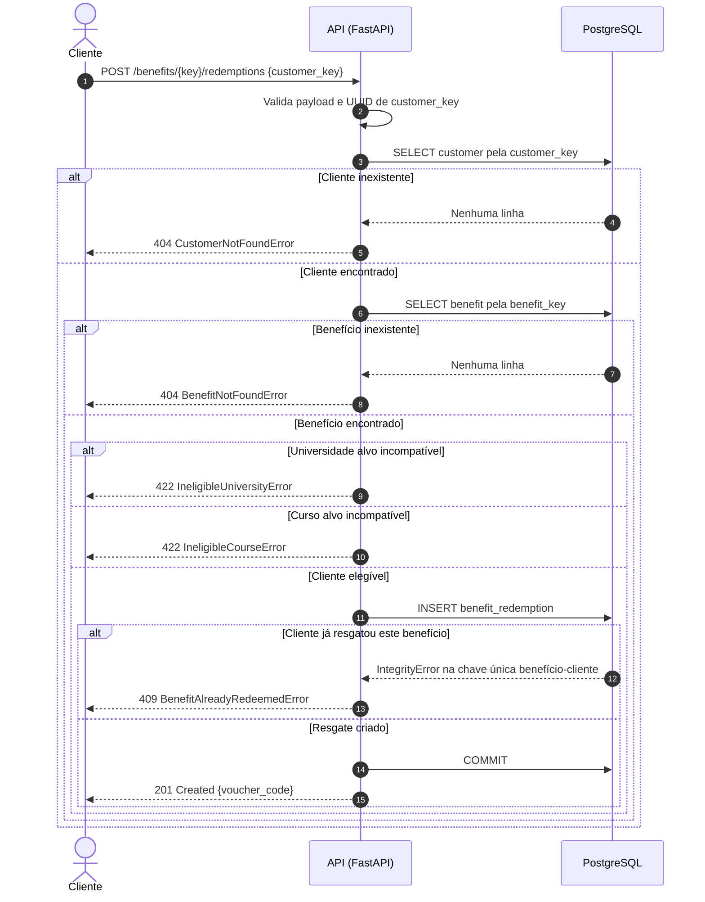

**13. Contratação de Seguro**

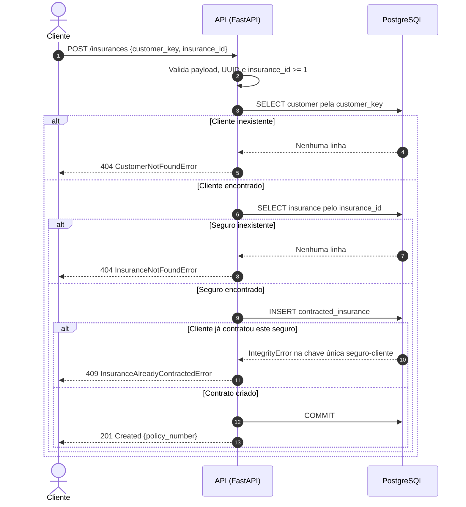

**14. Consulta de Extrato — paginação por cursor**

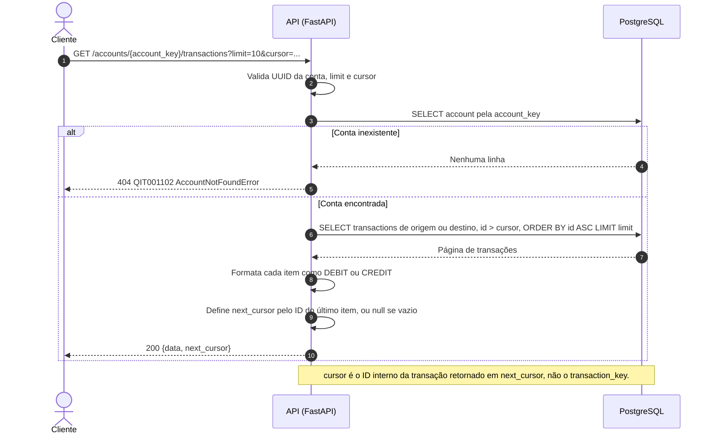

**15. Listagem do Catálogo de Benefícios**

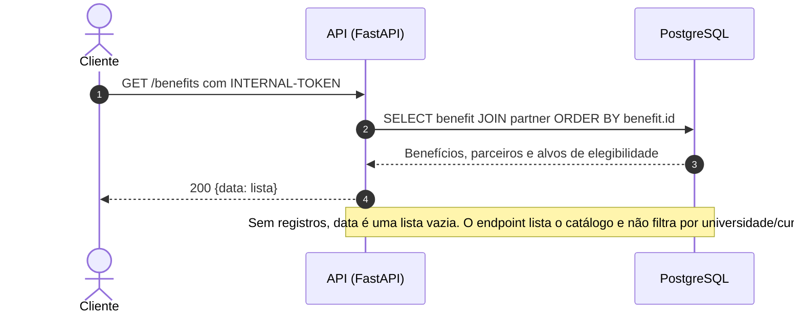
